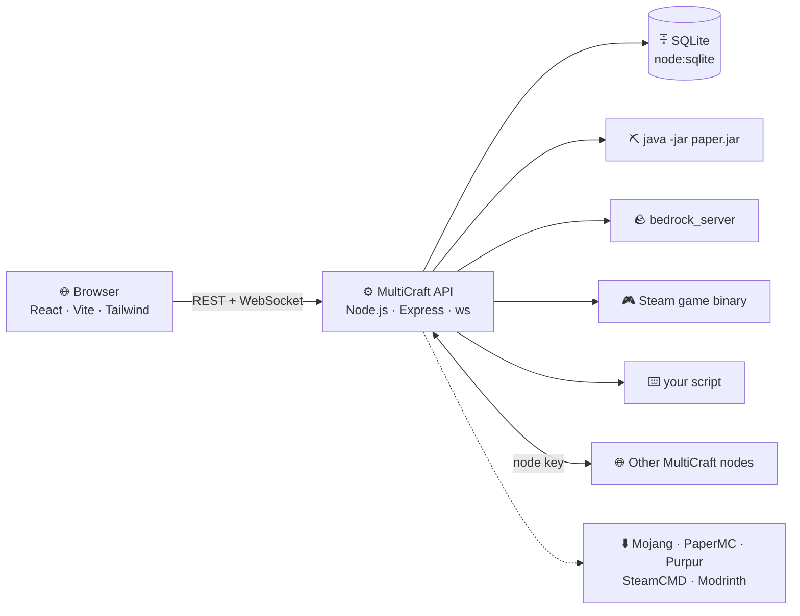

<p align="center">
  
</p>

<p align="center">
  
  
  
  
  
  
</p>

<h3 align="center">🎮 Create, run and monitor game servers from your browser.</h3>

<p align="center">
  ⛏️ Minecraft Java &amp; Bedrock &nbsp;·&nbsp; 🐾 Palworld &nbsp;·&nbsp; 🪖 Valheim &nbsp;·&nbsp; 🧟 Project Zomboid &nbsp;·&nbsp; 🌳 Terraria &nbsp;·&nbsp; 🎯 any Steam App ID &nbsp;·&nbsp; ⌨️ your own scripts
</p>

<p align="center">
  <a href="#-quick-start"><b>🚀 Quick start</b></a> &nbsp;•&nbsp;
  <a href="#-features"><b>✨ Features</b></a> &nbsp;•&nbsp;
  <a href="#-supported-games"><b>🎮 Games</b></a> &nbsp;•&nbsp;
  <a href="#-guides"><b>📚 Guides</b></a> &nbsp;•&nbsp;
  <a href="#%EF%B8%8F-operations"><b>🛠️ Operations</b></a> &nbsp;•&nbsp;
  <a href="#%EF%B8%8F-roadmap"><b>🗺️ Roadmap</b></a>
</p>

<br>

<p align="center">
  
  <br>
  <sub><i>Illustration of the dashboard — navigation drawer, live host gauges, and instances with per-instance metrics.</i></sub>
</p>

---

## 🚀 Quick start

> [!TIP]
> On **Debian/Ubuntu, Arch or Fedora**, `./install.sh` does all of this for you — Node.js, Java, build, a health check, and an optional systemd service.

```bash
git clone <this-repo-url> MultiCraft && cd MultiCraft
npm run setup        # 📦 install dependencies
npm run build        # 🏗️ build API + UI
npm start            # ▶️ http://localhost:8642
```

Open **http://localhost:8642** — the first visit walks you through creating the admin account. 🎉

| You need | For |
|---|---|
| 🟩 **Node.js 22.5+** (24 recommended) | the panel itself |
| ☕ **Java 21+** | Vanilla / Paper / Purpur / Spigot servers |
| 🛠️ **JDK + git** | building Spigot from source |
| 🧱 **32-bit libraries** (Linux) | Steam-based servers — [see Guides → Steam](#-guides) |

---

## ✨ Features

<table>
  <tr>
    <td width="33%" valign="top">
      <h4>🏗️ One-click installs</h4>
      Pick a platform and version from the live catalog — MultiCraft downloads and installs it. Spigot builds from source via BuildTools.
    </td>
    <td width="33%" valign="top">
      <h4>🚀 Launch control</h4>
      Choose the exact binary or jar, arguments, env vars, ready-detection and stop/restart behaviour — per instance.
    </td>
    <td width="33%" valign="top">
      <h4>⌨️ Custom servers</h4>
      Run any Linux server binary or shell script, with <code>{{PORT}}</code>-style variables and process-group shutdown.
    </td>
  </tr>
  <tr>
    <td valign="top">
      <h4>🖥️ Live console</h4>
      Real-time output over WebSocket, command history (↑/↓), and streamed install/update progress.
    </td>
    <td valign="top">
      <h4>📊 Metrics everywhere</h4>
      Host gauges and throughput on the dashboard; per-instance CPU, RAM, network, disk I/O and uptime.
    </td>
    <td valign="top">
      <h4>🧩 Plugins &amp; mods</h4>
      Modrinth search for plugins and data packs, plus uploads for Bedrock packs, BepInEx and <code>.pak</code> mods.
    </td>
  </tr>
  <tr>
    <td valign="top">
      <h4>📸 Snapshots</h4>
      Manual or scheduled, with retention. Restore everything — or diff one file against live and restore just that.
    </td>
    <td valign="top">
      <h4>👥 Fine-grained access</h4>
      Roles plus per-instance permissions, any number of instances per user — enforced by the API, not just the UI.
    </td>
    <td valign="top">
      <h4>🛑 Suspension</h4>
      Stop and lock an instance (non-payment, TOS). Owners lose panel and API access until it's lifted.
    </td>
  </tr>
  <tr>
    <td valign="top">
      <h4>🌐 Multi-node</h4>
      Link other MultiCraft hosts and transfer an instance's files and settings between them.
    </td>
    <td valign="top">
      <h4>👤 Players &amp; operators</h4>
      Op, kick, ban, whitelist/allowlist, broadcasts, time, weather and difficulty — from one page.
    </td>
    <td valign="top">
      <h4>🎨 Material 3 dark</h4>
      Tonal surfaces, a navigation drawer, list / grid / box views and smooth motion that respects <i>reduce motion</i>.
    </td>
  </tr>
</table>

<details>
<summary><b>…and the rest</b> 📁 files · ⬆️ updates · 💾 environment backup · 🧹 factory reset</summary>
<br>

- 📁 **File management** — browse, edit, upload, download, rename and delete (path-traversal safe).
- ⬆️ **Updates** — update a server in place while keeping worlds, `server.properties` and permission files.
- 💾 **Environment backup** — export/import the whole install as one zip.
- 🧹 **Factory reset** — wipe everything behind a multi-step confirmation (your old data is kept aside).
</details>

---

## 🎮 Supported games

| | Game | Plugins / mods | Default port |
|:-:|---|---|---|
| ⛏️ | **Minecraft: Java** — Paper · Purpur · Spigot | 🧩 Bukkit plugins — Modrinth + upload | `25565/tcp` |
| ⛏️ | **Minecraft: Java** — Vanilla | 📦 Data packs — Modrinth + upload | `25565/tcp` |
| 🪨 | **Minecraft: Bedrock** | 🎒 `.mcpack` / `.mcaddon`, auto-activated per world | `19132/udp` |
| 🪖 | **Valheim** | 🔌 BepInEx plugins (`.dll` / `.zip`) | `2456/udp` |
| 🐾 | **Palworld** | 📦 `.pak` mods | `8211/udp` |
| 🧟 | **Project Zomboid** | — *(Workshop IDs live in its own `.ini`)* | `16261/udp` |
| 🌳 | **Terraria** | — *(the vanilla server has no mod loader)* | `7777/tcp` |
| 🎯 | **Any Steam App ID** — CS2, TF2, Rust, ARK, Quake Live… | — | your choice |
| ⌨️ | **Custom** — any binary or shell script | — | your choice |

Known titles get their own emblem in the UI, and running instances wear a live 🟢 dot.

---

## 📚 Guides

<details>
<summary><h3>🚀 Custom servers &amp; launch settings</h3></summary>

**Custom instances** (admins only) run any Linux server binary or shell script. There's no download step: create it, upload your files in **File Management** (or point at an absolute path), and start it.

Every instance — custom or not — has a **Launch** card under **Configuration**, with a live preview of the exact command it will run:

| | Setting | What it does |
|:-:|---|---|
| 📄 | **Executable / jar** | Which binary, script or `.jar` starts (relative to the instance folder). |
| ☕ | **Java binary** | A specific `java` instead of the auto-detected one. *(admin)* |
| 🔤 | **Arguments** | Replaces the default arguments; quotes group words. |
| 🐚 | **Shell mode** | Runs through `/bin/sh -c` for pipes, `&&` and `$VARS`. *(admin, custom only)* |
| 📂 | **Working directory** | A subfolder to run in. |
| 🌱 | **Environment** | Extra variables for the process. |
| ✅ | **Ready pattern** | Output regex that marks the instance *running*. |
| 🛑 | **Stop by** | Console command(s), `SIGTERM`/`SIGINT`/`SIGQUIT`/`SIGHUP`, or a stop script *(admin)*. |
| 🔁 | **Restart by** | Stop → start, console command(s), or a restart script *(admin)*. |
| ⏱️ | **Force-stop after** | Seconds before a hung stop is killed (default 60). |

**Variables** work in the command, arguments, env values and scripts — and are exported to the process:

| Placeholder | Environment variable | Value |
|---|---|---|
| `{{PORT}}` | `SERVER_PORT` | the instance's port |
| `{{NAME}}` | `SERVER_NAME` | its name |
| `{{ID}}` | `SERVER_ID` | its internal id |
| `{{DIR}}` | `SERVER_DIR` | absolute path of its folder |
| `{{MIN_MEMORY}}` · `{{MAX_MEMORY}}` | `SERVER_MIN_MEMORY_MB` · `SERVER_MAX_MEMORY_MB` | memory settings (MB) |

> [!WARNING]
> A launch command can run **any program on the host** as the panel's user. Editing it needs the **Edit launch command** permission, which is never on by default — an admin grants it per user, per instance. Shell mode, absolute paths, a custom Java binary and stop/restart scripts stay admin-only.

</details>

<details>
<summary><h3>🧩 Plugins, data packs &amp; mods</h3></summary>

The **Manage → Plugins** page (called *Data Packs*, *Add-ons* or *Mods* where that fits) adapts to each game:

- **⛏️ Paper / Purpur / Spigot** — search Modrinth and install in one click (falling back to the newest build if your exact version isn't listed), or upload `.jar`s. Disabling renames to `.jar.disabled`.
- **⛏️ Vanilla** — data packs from Modrinth or uploaded `.zip`s into `<world>/datapacks`; they load on restart or with `/reload`.
- **🪨 Bedrock** — upload `.mcpack`, `.mcaddon` (nested packs included) or `.zip`. Packs are unpacked into `behavior_packs`/`resource_packs` and **activated for the world**; toggling adds/removes them.
- **🪖 Valheim** — BepInEx plugins (`.dll`, or a Thunderstore-style `.zip` unpacked into its own folder). Upload *BepInExPack_Valheim* to the instance root once and MultiCraft loads it automatically on Linux.
- **🐾 Palworld** — `.pak` mods into `Pal/Content/Paks/~mods`.

</details>

<details>
<summary><h3>📸 Snapshots</h3></summary>

Under each instance's **Backup Schedule**:

- ➕ **Create snapshot** — optionally labelled, e.g. `before-1.21-update`.
- ⏰ **Schedule** — presets or any cron expression, keeping the last *N*.
- ♻️ **Restore all** — replaces the instance's files (stop the server first).
- 🔀 **Restore one file** — open a snapshot, pick a file, review a **line-by-line diff** against the live copy, then restore just that file (works while running).

</details>

<details>
<summary><h3>👥 Users &amp; permissions</h3></summary>

Roles set the defaults; each user can be assigned **any number of instances**, each with its own permission set.

| Permission | Allows | Moderator | Viewer |
|---|---|:-:|:-:|
| ⚡ Start / stop | start, stop, restart, kill, retry install | ✅ | — |
| ⌨️ Console commands | send commands | ✅ | — |
| 👀 View files | browse/download files and snapshot contents | ✅ | ✅ |
| ✏️ Edit files | edit, upload, rename, delete | ✅ | — |
| 📸 Create snapshots | create/delete snapshots, edit the schedule | ✅ | — |
| ♻️ Restore snapshots | whole snapshots or single files | ✅ | — |
| 🧩 Plugins | install/toggle/remove plugins, mods, packs | ✅ | — |
| 👤 Players | op, kick, ban, whitelist | ✅ | — |
| ⚙️ Configuration | instance settings and `server.properties` | ✅ | — |
| ⬆️ Update | update the server software | ✅ | — |
| 🚀 Edit launch command | change what runs | — | — |

Admins can do everything. Every assigned user can see status, console output and the player list.

</details>

<details>
<summary><h3>🛑 Suspension &amp; 🌐 multiple nodes</h3></summary>

**🛑 Suspension** — in an instance's **Configuration** (admin): pick a reason and an optional note. The instance stops (gracefully, or killed immediately), can't be started, and its users see a *suspended* screen with the reason — in the panel and the API alike. Admins keep full access.

**🌐 Nodes** — under **Configuration → Nodes** every panel shows its *node key*. Add another MultiCraft host by URL + key, then transfer a stopped instance from its **Configuration** page; its files and settings stream across. Keep a stopped copy or remove the original afterwards.

> [!NOTE]
> Transfers move instances between hosts — they aren't automatic failover. Use HTTPS or a private network between nodes, since instance files travel over that connection.

</details>

<details>
<summary><h3>🎯 Steam-based servers</h3></summary>

Choose **Steam** when creating an instance, then a game:

| Game | App ID | Port | Notes |
|---|---|---|---|
| 🐾 Palworld | 2394010 | `8211/udp` | Doesn't reliably stop on a signal; force-stopped after a grace period (its autosave is kept). |
| 🧟 Project Zomboid | 380870 | `16261/udp` | Stops cleanly with `save` → `quit`. |
| 🪖 Valheim | 896660 | `2456/udp` | Stops with SIGINT — it only saves its world on SIGINT. |
| 🌳 Terraria | 105600 | `7777/tcp` | Fetched from terraria.org; started with `-autocreate`/`-world`. |
| 🎯 Other | any | any | Give its executable path; tune stop/restart under **Configuration → Launch**. |

Game config files are edited in **File Management**. Players, Operators, Whitelist and Map are Minecraft-only.

SteamCMD downloads itself once, automatically. On Linux it's 32-bit and needs:

| Distro | Command |
|---|---|
| 🍥 Debian/Ubuntu | `sudo dpkg --add-architecture i386 && sudo apt-get update && sudo apt-get install lib32gcc-s1 lib32stdc++6` |
| 🎩 Fedora | `sudo dnf install glibc.i686 libstdc++.i686` |
| 🦎 openSUSE | `sudo zypper install libstdc++6-32bit glibc-32bit` |
| 🏔️ Arch | enable `[multilib]` in `/etc/pacman.conf`, then `sudo pacman -S lib32-gcc-libs` |

- **Source of SteamCMD** — **Configuration → SteamCMD** (admin): Valve's official archive (default), a mirror URL, a local archive, or an existing install folder.
- **Per-instance options** — a *Steam login* (default `anonymous`; owned-license games need `username password`, Steam Guard prompts aren't supported) and *extra steamcmd flags*.

</details>

---

## 🛠️ Operations

<details>
<summary><b>🧰 Manual install</b> — Windows · Linux · macOS</summary>
<br>

| | 🪟 Windows | 🐧 Debian/Ubuntu | 🍎 macOS |
|---|---|---|---|
| **Node.js 22.5+** | `winget install OpenJS.NodeJS.LTS` | `curl -fsSL https://deb.nodesource.com/setup_22.x \| sudo bash -` → `sudo apt install -y nodejs` | `brew install node` |
| **Java 21+** | `winget install EclipseAdoptium.Temurin.21.JDK` | `sudo apt install -y openjdk-21-jre-headless` (`-jdk` for Spigot) | `brew install openjdk@21` |
| **Git** *(Spigot)* | `winget install Git.Git` | `sudo apt install -y git` | `brew install git` |

Then `npm run setup`, `npm run build`, `npm start`. For development with hot reload: `npm run dev` (API on `:8642`, UI on **http://localhost:5173**).

- 🪟 Can't reach the panel from another device? Allow TCP `8642` in **Windows Defender Firewall → Inbound Rules**.
- 🍎 Gatekeeper may ask about `bedrock_server` or a downloaded jar once — approve it in **System Settings → Privacy & Security**.
</details>

<details>
<summary><b>🔁 Running 24/7</b> — pm2 · systemd · Windows service · launchd</summary>
<br>

**🅰️ pm2** (any OS)

```bash
npm install -g pm2 && npm run build
pm2 start npm --name multicraft -- start
pm2 save && pm2 startup
```

**🅱️ systemd** (Linux) — run the panel as its own unprivileged user:

```bash
sudo useradd --system --create-home --home-dir /opt/multicraft --shell "$(command -v nologin)" multicraft
sudo git clone <this-repo-url> /opt/multicraft/app && sudo chown -R multicraft:multicraft /opt/multicraft
sudo -u multicraft bash -c 'cd /opt/multicraft/app && npm run setup && npm run build'
sudo -u multicraft mkdir -p /opt/multicraft/data
```

`/etc/systemd/system/multicraft.service`:

```ini
[Unit]
Description=MultiCraft panel
After=network.target

[Service]
Type=simple
WorkingDirectory=/opt/multicraft/app
ExecStart=/usr/bin/npm start
Restart=on-failure
User=multicraft
Environment=PORT=8642
Environment=MULTICRAFT_DATA_DIR=/opt/multicraft/data

[Install]
WantedBy=multi-user.target
```

```bash
sudo systemctl daemon-reload && sudo systemctl enable --now multicraft
journalctl -u multicraft -f
```

Packages for other distros: 🏔️ `pacman -S nodejs npm git jdk21-openjdk` · 🎩 `dnf install nodejs npm git java-21-openjdk-headless` · 🦎 `zypper install nodejs22 npm22 git java-21-openjdk-headless`.

Open ports: the panel's `8642` only needs to reach admins (consider HTTPS via a reverse proxy, or a VPN); each game server needs its own port open to players — e.g. `sudo ufw allow 25565/tcp` or `sudo firewall-cmd --permanent --add-port=25565/tcp && sudo firewall-cmd --reload`.

**🪟 Windows service** — with [NSSM](https://nssm.cc/download): `nssm install MultiCraft` → Path `C:\Program Files\nodejs\node.exe`, Startup directory = the MultiCraft folder, Arguments `server\dist\index.js` → `nssm start MultiCraft`.

**🍎 launchd** — `~/Library/LaunchAgents/com.multicraft.panel.plist`:

```xml
<?xml version="1.0" encoding="UTF-8"?>
<!DOCTYPE plist PUBLIC "-//Apple//DTD PLIST 1.0//EN" "http://www.apple.com/DTDs/PropertyList-1.0.dtd">
<plist version="1.0"><dict>
  <key>Label</key><string>com.multicraft.panel</string>
  <key>ProgramArguments</key><array><string>/usr/local/bin/npm</string><string>start</string></array>
  <key>WorkingDirectory</key><string>/path/to/MultiCraft</string>
  <key>RunAtLoad</key><true/>
  <key>KeepAlive</key><true/>
</dict></plist>
```

then `launchctl load ~/Library/LaunchAgents/com.multicraft.panel.plist`.

> [!NOTE]
> These keep the *panel* running. Whether an instance starts with it is the **“Automatically start this instance when the panel boots”** box in its **Configuration**.
</details>

<details>
<summary><b>⬆️ Updating MultiCraft</b></summary>
<br>

```bash
./update.sh               # recommended
```

Backs up `server/data/` first, records the current commit, `git pull --ff-only`s, rebuilds, and test-starts the new build before touching your live service — offering an instant rollback if it fails. `-y` runs it unattended; `--rollback` restores the previous commit.

Manual: `git pull && npm run setup && npm run build`, then restart (`pm2 restart multicraft` / `sudo systemctl restart multicraft` / …).

> [!CAUTION]
> Never run `git clean -fdx` in the repo — `server/data/` is git-ignored, and `git clean` deletes ignored files: your database, every instance and every snapshot.
</details>

<details>
<summary><b>💾 Backing up, moving &amp; wiping data</b></summary>
<br>

Everything — database, instances, snapshots — lives in **`server/data/`** (or `MULTICRAFT_DATA_DIR`).

- 📤 **Export / 📥 import** — **Configuration → Environment backup & restore** (admin). Import replaces the whole install; your current data is renamed to `server/data-pre-import-<timestamp>/`, not deleted. Sign in afterwards with an admin from the *imported* backup.
- 📦 **Move it out of the repo** (recommended for production) — set `MULTICRAFT_DATA_DIR=/var/lib/multicraft` in your service definition.
- 🧹 **Start fresh** — **Configuration → Danger zone → Delete everything & start fresh** (three confirmations; old data is kept as `data-pre-reset-…`). By hand: stop MultiCraft and empty `server/data/`.

Importing across operating systems doesn't convert platform binaries (e.g. `bedrock_server.exe`) — use the instance's **Update** page afterwards.
</details>

<details>
<summary><b>🗑️ Uninstalling (Linux)</b></summary>
<br>

```bash
./uninstall.sh            # asks before every step
./uninstall.sh -y         # removes service, processes and build output; keeps data + packages
./uninstall.sh -y --purge # removes everything, including data, packages and the checkout
```

It stops the panel and its game servers, removes `multicraft.service` or the pm2 entry and the panel's firewall rule, deletes data and `update.sh` backups (typing `delete` to confirm), and offers to remove Node.js, Java, steamcmd's 32-bit libraries and the `multicraft` user. git and curl are never removed without asking.
</details>

---

## 🏗️ Architecture



- 🗄️ **Zero native dependencies** — SQLite via `node:sqlite`; HMAC session tokens and `scrypt` hashing via `node:crypto`.
- ⚙️ **Plain child processes** — console output and player events stream to the browser over WebSocket; custom instances run in their own process group so scripts' children stop too.
- 📊 **Metrics from `/proc`** on Linux (`Get-Process` on Windows). Network figures are host-wide — the OS doesn't count network bytes per process.
- ⬆️ **Safe updates** — Java re-installs only the jar; Bedrock skips `worlds/`, `server.properties` and permission files; Steam re-runs `steamcmd +app_update`.

```
MultiCraft/
├── server/   ⚙️  API — Express, ws, node:sqlite
├── web/      🎨  UI — React, Vite, Tailwind (Material 3 dark)
└── docs/     🖼️  README artwork
```

---

## 📝 Good to know

- 📜 Java servers require accepting Mojang's EULA at creation; MultiCraft writes `eula.txt` for you.
- 👤 Op/kick/ban go through the live console, so the server must be running. Whitelist edits work either way.
- ⬆️ Updating a server needs it stopped; tick *create a backup first* on its **Update** page for a safety snapshot.

## 🗺️ Roadmap

- [x] 🎨 Material 3 redesign with list / grid / box views
- [x] 🚀 Custom launch executables, jars and custom script servers
- [x] 📸 Snapshots with per-file diff &amp; restore
- [ ] 🧱 Mohist and SpongeForge instances
- [ ] ⏪ Restore view for Minecraft's own auto-save states

<p align="center"><sub>Made with 💚 for people who'd rather play than SSH.</sub></p>
