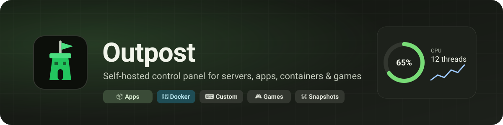
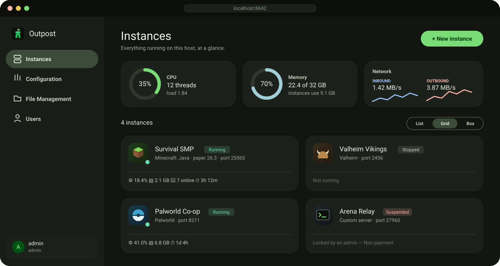
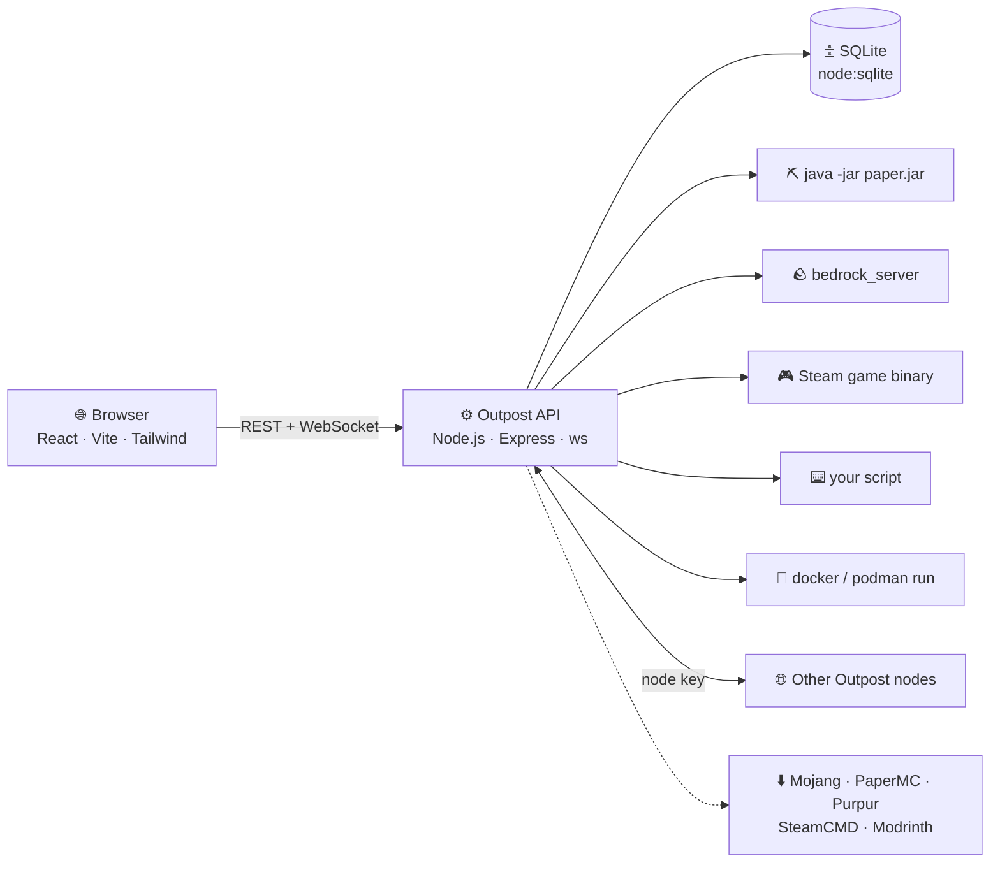

<p align="center">
  
</p>

<p align="center">
  
  
  
  
  
  
</p>

<h3 align="center">🧭 One self-hosted panel for your servers, apps, containers and games.</h3>

<p align="center">
  📦 Web apps &amp; databases &nbsp;·&nbsp; 🧭 Portainer &nbsp;·&nbsp; 🐳 any Docker / Podman image &nbsp;·&nbsp; 🎮 Minecraft &amp; Steam game servers &nbsp;·&nbsp; ⌨️ your own scripts
</p>

<p align="center">
  <a href="#-quick-start"><b>🚀 Quick start</b></a> &nbsp;•&nbsp;
  <a href="#-features"><b>✨ Features</b></a> &nbsp;•&nbsp;
  <a href="#-what-you-can-run"><b>🧰 What you can run</b></a> &nbsp;•&nbsp;
  <a href="#-guides"><b>📚 Guides</b></a> &nbsp;•&nbsp;
  <a href="#%EF%B8%8F-operations"><b>🛠️ Operations</b></a> &nbsp;•&nbsp;
  <a href="#%EF%B8%8F-roadmap"><b>🗺️ Roadmap</b></a>
</p>

<br>

<p align="center">
  
  <br>
  <sub><i>Illustration of the dashboard — navigation drawer, live host gauges, and instances with per-instance metrics.</i></sub>
</p>

---

## 🚀 Quick start

> [!TIP]
> On **Debian/Ubuntu, Arch or Fedora**, `./install.sh` does all of this for you — Node.js, Java, the **bubblewrap** sandbox, a **container engine** for Docker/Portainer/app instances (enabled with systemd), the build, a health check, and an optional `outpost.service`.
>
> ```bash
> ./install.sh                    # asks as it goes (container engine: Docker by default)
> ./install.sh --engine=podman    # rootless Podman instead — no root daemon, no docker group
> ./install.sh -y                 # accept every default
> ./install.sh --no-containers    # skip the container engine
> ```
>
> With **Docker** it installs `docker.io` / `moby-engine` / `docker`, enables `docker.service` + `docker.socket` and adds you to the `docker` group (root-equivalent — log out and back in afterwards). With **Podman** it installs `podman`, enables your user's `podman.socket` (what Portainer talks to) and turns on lingering so it runs without a login. Either way it can pre-download the Portainer image.

```bash
git clone <this-repo-url> Outpost && cd Outpost
npm run setup        # 📦 install dependencies
npm run build        # 🏗️ build API + UI
npm start            # ▶️ http://localhost:8642
```

Open **http://localhost:8642** — the first visit walks you through creating the admin account. 🎉

| You need | For |
|---|---|
| 🟩 **Node.js 22.5+** (24 recommended) | the panel itself |
| ☕ **Java 21+** | Vanilla / Paper / Purpur / Spigot servers |
| 🛠️ **JDK + git** | building Spigot from source |
| 🧱 **32-bit libraries** (Linux) | Steam-based servers — [see Guides → Steam](#-guides) |

---

## ✨ Features

<table>
  <tr>
    <td width="33%" valign="top">
      <h4>🏗️ One-click installs</h4>
      Pick a platform and version from the live catalog — Outpost downloads and installs it. Spigot builds from source via BuildTools.
    </td>
    <td width="33%" valign="top">
      <h4>🚀 Launch control</h4>
      Choose the exact binary or jar, arguments, env vars, ready-detection and stop/restart behaviour — per instance.
    </td>
    <td width="33%" valign="top">
      <h4>⌨️ Custom servers</h4>
      Run any Linux server binary or shell script, with <code>{{PORT}}</code>-style variables and process-group shutdown.
    </td>
  </tr>
  <tr>
    <td valign="top">
      <h4>🖥️ Live console</h4>
      Real-time output over WebSocket, command history (↑/↓), and streamed install/update progress.
    </td>
    <td valign="top">
      <h4>📊 Metrics everywhere</h4>
      Host gauges and throughput on the dashboard; per-instance CPU, RAM, network, disk I/O and uptime.
    </td>
    <td valign="top">
      <h4>🧩 Plugins &amp; mods</h4>
      Modrinth search for plugins and data packs, plus uploads for Bedrock packs, BepInEx and <code>.pak</code> mods.
    </td>
  </tr>
  <tr>
    <td valign="top">
      <h4>📸 Snapshots</h4>
      Manual or scheduled, with retention. Restore everything — or diff one file against live and restore just that.
    </td>
    <td valign="top">
      <h4>👥 Fine-grained access</h4>
      Roles plus per-instance permissions, any number of instances per user — enforced by the API, not just the UI.
    </td>
    <td valign="top">
      <h4>🛑 Suspension</h4>
      Stop and lock an instance (non-payment, TOS). Owners lose panel and API access until it's lifted.
    </td>
  </tr>
  <tr>
    <td valign="top">
      <h4>🌐 Multi-node</h4>
      Link other Outpost hosts and transfer an instance's files and settings between them.
    </td>
    <td valign="top">
      <h4>🔌 UPnP port forwarding</h4>
      Forward ports and ranges on your router straight from the panel — automatically while an instance runs.
    </td>
  </tr>
  <tr>
    <td valign="top">
      <h4>♻️ Auto-restart</h4>
      Bring an instance back when it crashes — or whenever it stops — with a delay and an optional attempt limit.
    </td>
    <td valign="top">
      <h4>🐳 Docker &amp; Podman</h4>
      Run any game image in a container that only sees its own folder — with presets for popular game images.
    </td>
  </tr>
  <tr>
    <td valign="top">
      <h4>🛡️ Sandboxed by default</h4>
      Game processes are confined to their own folder with bubblewrap; the panel never follows a symlink out of one.
    </td>
    <td valign="top">
      <h4>👤 Players &amp; operators</h4>
      Op, kick, ban, whitelist/allowlist, broadcasts, time, weather and difficulty — from one page.
    </td>
    <td valign="top">
      <h4>🎨 Material 3 dark</h4>
      Tonal surfaces, a navigation drawer, list / grid / box views and smooth motion that respects <i>reduce motion</i>.
    </td>
  </tr>
</table>

<details>
<summary><b>…and the rest</b> 📁 files · ⬆️ updates · 💾 environment backup · 🧹 factory reset</summary>
<br>

- 📁 **File management** — browse, edit, upload, download, rename and delete (path-traversal safe).
- ⬆️ **Updates** — update a server in place while keeping worlds, `server.properties` and permission files.
- 💾 **Environment backup** — export/import the whole install as one zip.
- 🧹 **Factory reset** — wipe everything behind a multi-step confirmation (your old data is kept aside).
</details>

---

## 🧰 What you can run

Click **New instance** and pick what to create:

| | Option | What you get | Who |
|:-:|---|---|---|
| 📦 | **App from the catalog** | One-click web apps, databases, media servers and tools (below) — pre-wired ports, folders and a web UI link | admins · users with container access |
| 🧭 | **Portainer** | A full container-management UI for this host, set up in one click | admins · users with Portainer access |
| 🐳 | **Docker container** | Any image from Docker Hub, GHCR or your own registry | admins · users with *any image* access |
| 🎮 | **Game server** | Minecraft Java/Bedrock or Steam dedicated servers — installed, updated and modded for you | anyone allowed to create |
| ⌨️ | **Custom process** | Any Linux binary or shell script with your own start/stop/restart commands | admins |

The Instances page groups everything with **🎮 Games · 📦 Apps · 🐳 Containers · ⌨️ Custom** filters, and anything with a web interface gets an **Open web UI** button.

### 📦 App catalog

| Section | Apps |
|---|---|
| 🧭 Platform tools | **Portainer** (container management) · **Uptime Kuma** (uptime monitoring & status pages) |
| 🌐 Web & apps | **Nginx** (static sites from the instance's `html` folder) · **Vaultwarden** (Bitwarden-compatible passwords) |
| 🗄️ Databases | **PostgreSQL** · **MariaDB** · **Redis** |
| 🎞️ Media & files | **Jellyfin** (media streaming) · **File Browser** (share files) |
| 🎮 Games | Minecraft Java & Bedrock, Valheim, Palworld, Counter-Strike 2 (as containers) |

Every template is just a starting point — change the image, ports, environment, folders and limits before creating, or later under **Configuration → Container**.

### 🎮 Game servers

| | Game | Plugins / mods | Default port |
|:-:|---|---|---|
| ⛏️ | **Minecraft: Java** — Paper · Purpur · Spigot | 🧩 Bukkit plugins — Modrinth + upload | `25565/tcp` |
| ⛏️ | **Minecraft: Java** — Vanilla | 📦 Data packs — Modrinth + upload | `25565/tcp` |
| 🪨 | **Minecraft: Bedrock** | 🎒 `.mcpack` / `.mcaddon`, auto-activated per world | `19132/udp` |
| 🪖 | **Valheim** | 🔌 BepInEx plugins (`.dll` / `.zip`) | `2456/udp` |
| 🐾 | **Palworld** | 📦 `.pak` mods | `8211/udp` |
| 🧟 | **Project Zomboid** | — *(Workshop IDs live in its own `.ini`)* | `16261/udp` |
| 🌳 | **Terraria** | — *(the vanilla server has no mod loader)* | `7777/tcp` |
| 🎯 | **Any Steam App ID** — CS2, TF2, Rust, ARK, Quake Live… | — | your choice |

Known titles and app types get their own emblem, and running instances wear a live 🟢 dot.

---

## 📚 Guides

<details>
<summary><h3>🚀 Custom servers &amp; launch settings</h3></summary>

**Custom instances** (admins only) run any Linux server binary or shell script. There's no download step: create it, upload your files in **File Management** (or point at an absolute path), and start it.

Every instance — custom or not — has a **Launch** card under **Configuration**, with a live preview of the exact command it will run:

| | Setting | What it does |
|:-:|---|---|
| 📄 | **Executable / jar** | Which binary, script or `.jar` starts (relative to the instance folder). |
| ☕ | **Java binary** | A specific `java` instead of the auto-detected one. *(admin)* |
| 🔤 | **Arguments** | Replaces the default arguments; quotes group words. |
| 🐚 | **Shell mode** | Runs through `/bin/sh -c` for pipes, `&&` and `$VARS`. *(admin, custom only)* |
| 📂 | **Working directory** | A subfolder to run in. |
| 🌱 | **Environment** | Extra variables for the process. |
| ✅ | **Ready pattern** | Output regex that marks the instance *running*. |
| 🛑 | **Stop by** | Console command(s), `SIGTERM`/`SIGINT`/`SIGQUIT`/`SIGHUP`, or a stop script *(admin)*. |
| 🔁 | **Restart by** | Stop → start, console command(s), or a restart script *(admin)*. |
| ⏱️ | **Force-stop after** | Seconds before a hung stop is killed (default 60). |

**Variables** work in the command, arguments, env values and scripts — and are exported to the process:

| Placeholder | Environment variable | Value |
|---|---|---|
| `{{PORT}}` | `SERVER_PORT` | the instance's port |
| `{{NAME}}` | `SERVER_NAME` | its name |
| `{{ID}}` | `SERVER_ID` | its internal id |
| `{{DIR}}` | `SERVER_DIR` | absolute path of its folder |
| `{{MIN_MEMORY}}` · `{{MAX_MEMORY}}` | `SERVER_MIN_MEMORY_MB` · `SERVER_MAX_MEMORY_MB` | memory settings (MB) |

> [!WARNING]
> A launch command can run **any program on the host** as the panel's user. Editing it needs the **Edit launch command** permission, which is never on by default — an admin grants it per user, per instance. Shell mode, absolute paths, a custom Java binary and stop/restart scripts stay admin-only.

</details>

<details>
<summary><h3>🧩 Plugins, data packs &amp; mods</h3></summary>

The **Manage → Plugins** page (called *Data Packs*, *Add-ons* or *Mods* where that fits) adapts to each game:

- **⛏️ Paper / Purpur / Spigot** — search Modrinth and install in one click (falling back to the newest build if your exact version isn't listed), or upload `.jar`s. Disabling renames to `.jar.disabled`.
- **⛏️ Vanilla** — data packs from Modrinth or uploaded `.zip`s into `<world>/datapacks`; they load on restart or with `/reload`.
- **🪨 Bedrock** — upload `.mcpack`, `.mcaddon` (nested packs included) or `.zip`. Packs are unpacked into `behavior_packs`/`resource_packs` and **activated for the world**; toggling adds/removes them.
- **🪖 Valheim** — BepInEx plugins (`.dll`, or a Thunderstore-style `.zip` unpacked into its own folder). Upload *BepInExPack_Valheim* to the instance root once and Outpost loads it automatically on Linux.
- **🐾 Palworld** — `.pak` mods into `Pal/Content/Paks/~mods`.

</details>

<details>
<summary><h3>📸 Snapshots</h3></summary>

Under each instance's **Backup Schedule**:

- ➕ **Create snapshot** — optionally labelled, e.g. `before-1.21-update`.
- ⏰ **Schedule** — presets or any cron expression, keeping the last *N*.
- ♻️ **Restore all** — replaces the instance's files (stop the server first).
- 🔀 **Restore one file** — open a snapshot, pick a file, review a **line-by-line diff** against the live copy, then restore just that file (works while running).

</details>

<details>
<summary><h3>👥 Users &amp; permissions</h3></summary>

Roles set the defaults; each user can be assigned **any number of instances**, each with its own permission set.

| Permission | Allows | Moderator | Viewer |
|---|---|:-:|:-:|
| ⚡ Start / stop | start, stop, restart, kill, retry install | ✅ | — |
| ⌨️ Console commands | send commands | ✅ | — |
| 👀 View files | browse/download files and snapshot contents | ✅ | ✅ |
| ✏️ Edit files | edit, upload, rename, delete | ✅ | — |
| 📸 Create snapshots | create/delete snapshots, edit the schedule | ✅ | — |
| ♻️ Restore snapshots | whole snapshots or single files | ✅ | — |
| 🧩 Plugins | install/toggle/remove plugins, mods, packs | ✅ | — |
| 👤 Players | op, kick, ban, whitelist | ✅ | — |
| ⚙️ Configuration | instance settings and `server.properties` | ✅ | — |
| ⬆️ Update | update the server software | ✅ | — |
| 🚀 Edit launch command | change what runs | — | — |
| 🔌 UPnP port forwarding | open router ports to this host | — | — |

Admins can do everything. Every assigned user can see status, console output and the player list.

#### ➕ Creating instances &amp; ownership

Each user also has an **Instance creation** policy (Users → Edit), either the role's default or their own:

| | Moderator default | Viewer default | Custom per user |
|---|:-:|:-:|---|
| ➕ Can create instances | ✅ | — | on / off |
| 🎮 Allowed types | Java · Bedrock · Steam | — | any of Java · Bedrock · Steam |
| 🔢 Max instances owned | no limit | — | e.g. 3 |
| 🧠 Max memory per instance | no limit | — | e.g. 4096 MB |
| 🐳 Containers | — | — | none · 📦 catalog apps only · any image |
| 🧭 Portainer &amp; engine access | — | — | on / off |

- 👤 **Every new instance is owned by its creator**, who automatically gets full control of it (everything except *Edit launch command* and *UPnP*, which stay opt-in) and can delete it. Its header shows *You own this* / *Owner: …*.
- 🔁 **Admins can hand an instance to someone else** under its **Configuration → Owner**; the new owner gets owner access and it counts toward *their* limit.
- 🧾 Deleting a user keeps their instances (ownership simply clears).
- 🐳 **Container access is granted per user.** *Catalog apps only* lets them create the templates in **New instance → App from the catalog**, always with the catalog's image; *Any image* allows any container. Either way containers only see their own folder, and non-admins can't publish host ports below 1024 or the panel's own port. Owners can edit their container's settings within the same limits.
- 🧭 **Portainer & engine access** is a separate switch: it lets a user run Portainer (or any container manager) with the engine socket — control over every container on the host, and with rootful Docker effectively the host. Give it only to people you'd trust as admin.
- 🔒 Custom processes can only be created by admins.

</details>

<details>
<summary><h3>🛡️ Security &amp; isolation</h3></summary>

Every instance is kept to its own folder — on by default, managed under **Configuration → Security**:

| Layer | What it stops |
|---|---|
| 🛡️ **Process sandbox** (bubblewrap, Linux) | The game can only write inside its instance folder (plus a private `/tmp`). System folders are read-only; your home folder, other instances and the panel's database/session secret don't exist inside the sandbox. `HOME` points at `<instance>/.home`. |
| 🔗 **Symlink-proof file access** | A server, plugin or script can create `ln -s / escape` in its folder — the panel refuses to follow links out of the instance for browsing, editing, uploads, plugins and snapshot restores (an escaping link can still be deleted). |
| 📤 **Safe uploads** | Uploaded file names are reduced to a plain name, so `../../file` can't land outside the folder. |
| 🧹 **Clean environment** | Instances never inherit the panel's environment variables — no `OUTPOST_*` secrets or credentials that happened to be exported. |
| 🐳 **Containers** | Docker instances only see their mounted folder, with memory, CPU and process limits and `no-new-privileges`. |

Graceful stops still work in the sandbox — signals go straight to the game (e.g. Valheim's SIGINT save). Steam games get `~/.steam/sdk64/steamclient.so` linked from their own folder. Each instance shows its status under **Configuration → Isolation**; an admin can opt a single instance out if it truly needs files elsewhere.

> [!NOTE]
> The sandbox needs **bubblewrap** (`bwrap`) — already present wherever Flatpak is installed; otherwise `sudo apt install bubblewrap` / `dnf install bubblewrap` / `pacman -S bubblewrap`. Without it (or on Windows/macOS) the other layers still apply, and the Security card says why the sandbox is unavailable.

</details>

<details>
<summary><h3>🧭 Portainer &amp; the app catalog</h3></summary>

**Portainer** is one click away: **New instance → Portainer**. Outpost runs `portainer/portainer-ce:lts` with its data in the instance folder, publishes `9443` (HTTPS UI) and `8000`, and adds an **Open web UI** button. Open it within 5 minutes to create Portainer's admin account, then pick the *local* environment.

Portainer manages the container engine itself, so it's the one template that mounts the engine's API socket (`/var/run/docker.sock` inside the container). That gives it control over **every container on the host** — keep it admin-only and behind your network.

> [!TIP]
> On **Podman**, the API socket isn't running by default. Enable it once — `systemctl --user enable --now podman.socket` — and the Docker page will show it as available. With Docker it's `/var/run/docker.sock`. Point `OUTPOST_ENGINE_SOCKET` elsewhere if yours lives somewhere unusual.

The other catalog apps work the same way: pick one, review its settings, create. A few need a value changed first (database passwords, Vaultwarden behind HTTPS) — the dialog says so.

</details>

<details>
<summary><h3>🐳 Docker instances</h3></summary>

The **Docker** page shows your container engine and only your container-backed instances. It works with **Docker** or **Podman** — Podman runs rootless with no daemon, which is the safest option.

- ➕ **New Docker instance** *(admin)* — pick a preset (⛏️ Minecraft Java · 🪨 Bedrock · 🪖 Valheim · 🐾 Palworld · 🎯 CS2) or any image, then set ports, environment variables, the mount path, a CPU limit and an optional command. The image is pulled immediately.
- 📦 **Only its own folder** — the instance folder is the single host folder mounted into the container (at `/data` by default). Memory limit = the instance's *Max memory*; plus a process limit and `no-new-privileges`.
- 🖥️ **Everything else works as usual** — live console with input, start/stop/restart (signals are passed into the container), auto-restart, snapshots, File Management, UPnP and **per-container CPU, memory, network and disk metrics**.
- ✏️ **Change settings later** under the instance's **Configuration → Container**; **Update** pulls the image tag again.
- 👤 **Run as the panel's user** keeps files the container writes editable from File Management (turn it off for images that must start as root).
- 📂 **Extra folders** — mount subfolders of the instance (e.g. `media` → `/media`); the container still can't see anything outside its instance.
- 🌐 **Web interface** — mark a published port as the app's UI to get an **Open web UI** button (custom processes can do the same under **Launch**).
- 🔌 **Engine socket** — opt-in, admin-only, for container managers like Portainer (see above).

> [!WARNING]
> Access to the Docker daemon is root-equivalent on most hosts. Admins decide per user who may run containers (catalog apps only or any image) and who may use Portainer — see **Users & permissions**. Prefer rootless Podman or rootless Docker.

Pin an engine with `OUTPOST_CONTAINER_ENGINE=docker` or `podman`.

</details>

<details>
<summary><h3>🔌 UPnP port forwarding</h3></summary>

Each instance has a **UPnP** tab that asks your router (via UPnP IGD) to forward ports to this machine — no router admin page needed.

- 📡 **Router card** — the router Outpost found, this host's LAN address and your public IP.
- 🔢 **Rules** — single ports or ranges (up to 256 per rule), TCP, UDP or both, mapped one-to-one (`27015–27020` → `27015–27020`, or shifted to another local range).
- ⚡ **Forward now / Remove forwarding** — apply or clear on demand, with a per-port result (✅ / ❌ and the router's reason).
- 🔁 **Forward automatically while running** — opens the ports when the instance starts and closes them when it stops.
- ⏳ **Leases** — 30 min to 24 h (renewed automatically), or permanent. A timed lease lets the router drop the forwarding on its own if the panel goes away.
- 🗒️ **Forwarded right now** — every UPnP mapping the router currently points at this machine.

> [!IMPORTANT]
> Forwarding exposes this machine to the internet, so it needs the **UPnP port forwarding** permission (never on by default). Non-admins can't forward ports below 1024 or the panel's own port.

> [!TIP]
> **Router not found?** Turn on UPnP in the router and keep the host on the same network (discovery doesn't cross VPNs or Docker bridge networks). Host firewalls often drop the router's replies — with firewalld:
> `sudo firewall-cmd --permanent --add-service=upnp-client && sudo firewall-cmd --reload`.
> You can also skip discovery by pointing `OUTPOST_UPNP_GATEWAY` at the router's description URL (e.g. `http://192.168.0.1:5000/rootDesc.xml`).

</details>

<details>
<summary><h3>♻️ Auto-restart</h3></summary>

In an instance's **Configuration → General → Automatic restart**:

| Policy | Restarts when the process… |
|---|---|
| ⛔ **Never** | — (default) |
| 💥 **Crashes or fails** | exits with an error code or is killed by a signal |
| 🔁 **Stops for any reason** | exits in any way the panel didn't ask for — including an in-game `stop` |

- ⏱️ **Wait before restarting** — seconds between the exit and the restart.
- 🔢 **Give up after** — consecutive attempts before stopping (`0` = keep going forever). A run of 10 minutes or more counts as healthy and resets the count.
- 🛑 Stopping from the panel never triggers a restart, and pressing **Stop** during the countdown cancels it. Suspending an instance cancels it too.

</details>

<details>
<summary><h3>🛑 Suspension &amp; 🌐 multiple nodes</h3></summary>

**🛑 Suspension** — in an instance's **Configuration** (admin): pick a reason and an optional note. The instance stops (gracefully, or killed immediately), can't be started, and its users see a *suspended* screen with the reason — in the panel and the API alike. Admins keep full access.

**🌐 Nodes** — under **Configuration → Nodes** every panel shows its *node key*. Add another Outpost host by URL + key, then transfer a stopped instance from its **Configuration** page; its files and settings stream across. Keep a stopped copy or remove the original afterwards.

> [!NOTE]
> Transfers move instances between hosts — they aren't automatic failover. Use HTTPS or a private network between nodes, since instance files travel over that connection.

</details>

<details>
<summary><h3>🎯 Steam-based servers</h3></summary>

Choose **Steam** when creating an instance, then a game:

| Game | App ID | Port | Notes |
|---|---|---|---|
| 🐾 Palworld | 2394010 | `8211/udp` | Doesn't reliably stop on a signal; force-stopped after a grace period (its autosave is kept). |
| 🧟 Project Zomboid | 380870 | `16261/udp` | Stops cleanly with `save` → `quit`. |
| 🪖 Valheim | 896660 | `2456/udp` | Stops with SIGINT — it only saves its world on SIGINT. |
| 🌳 Terraria | 105600 | `7777/tcp` | Fetched from terraria.org; started with `-autocreate`/`-world`. |
| 🎯 Other | any | any | Give its executable path; tune stop/restart under **Configuration → Launch**. |

Game config files are edited in **File Management**. Players, Operators, Whitelist and Map are Minecraft-only.

SteamCMD downloads itself once, automatically. On Linux it's 32-bit and needs:

| Distro | Command |
|---|---|
| 🍥 Debian/Ubuntu | `sudo dpkg --add-architecture i386 && sudo apt-get update && sudo apt-get install lib32gcc-s1 lib32stdc++6` |
| 🎩 Fedora | `sudo dnf install glibc.i686 libstdc++.i686` |
| 🦎 openSUSE | `sudo zypper install libstdc++6-32bit glibc-32bit` |
| 🏔️ Arch | enable `[multilib]` in `/etc/pacman.conf`, then `sudo pacman -S lib32-gcc-libs` |

- **Source of SteamCMD** — **Configuration → SteamCMD** (admin): Valve's official archive (default), a mirror URL, a local archive, or an existing install folder.
- **Per-instance options** — a *Steam login* (default `anonymous`; owned-license games need `username password`, Steam Guard prompts aren't supported) and *extra steamcmd flags*.

</details>

---

## 🛠️ Operations

<details>
<summary><b>🧰 Manual install</b> — Windows · Linux · macOS</summary>
<br>

| | 🪟 Windows | 🐧 Debian/Ubuntu | 🍎 macOS |
|---|---|---|---|
| **Node.js 22.5+** | `winget install OpenJS.NodeJS.LTS` | `curl -fsSL https://deb.nodesource.com/setup_22.x \| sudo bash -` → `sudo apt install -y nodejs` | `brew install node` |
| **Java 21+** | `winget install EclipseAdoptium.Temurin.21.JDK` | `sudo apt install -y openjdk-21-jre-headless` (`-jdk` for Spigot) | `brew install openjdk@21` |
| **Git** *(Spigot)* | `winget install Git.Git` | `sudo apt install -y git` | `brew install git` |

Then `npm run setup`, `npm run build`, `npm start`. For development with hot reload: `npm run dev` (API on `:8642`, UI on **http://localhost:5173**).

- 🪟 Can't reach the panel from another device? Allow TCP `8642` in **Windows Defender Firewall → Inbound Rules**.
- 🍎 Gatekeeper may ask about `bedrock_server` or a downloaded jar once — approve it in **System Settings → Privacy & Security**.
</details>

<details>
<summary><b>🔁 Running 24/7</b> — pm2 · systemd · Windows service · launchd</summary>
<br>

**🅰️ pm2** (any OS)

```bash
npm install -g pm2 && npm run build
pm2 start npm --name outpost -- start
pm2 save && pm2 startup
```

**🅱️ systemd** (Linux) — run the panel as its own unprivileged user:

```bash
sudo useradd --system --create-home --home-dir /opt/outpost --shell "$(command -v nologin)" outpost
sudo git clone <this-repo-url> /opt/outpost/app && sudo chown -R outpost:outpost /opt/outpost
sudo -u outpost bash -c 'cd /opt/outpost/app && npm run setup && npm run build'
sudo -u outpost mkdir -p /opt/outpost/data
```

`/etc/systemd/system/outpost.service`:

```ini
[Unit]
Description=Outpost panel
After=network.target

[Service]
Type=simple
WorkingDirectory=/opt/outpost/app
ExecStart=/usr/bin/npm start
Restart=on-failure
User=outpost
Environment=PORT=8642
Environment=OUTPOST_DATA_DIR=/opt/outpost/data

[Install]
WantedBy=multi-user.target
```

```bash
sudo systemctl daemon-reload && sudo systemctl enable --now outpost
journalctl -u outpost -f
```

Packages for other distros: 🏔️ `pacman -S nodejs npm git jdk21-openjdk` · 🎩 `dnf install nodejs npm git java-21-openjdk-headless` · 🦎 `zypper install nodejs22 npm22 git java-21-openjdk-headless`.

Open ports: the panel's `8642` only needs to reach admins (consider HTTPS via a reverse proxy, or a VPN); each game server needs its own port open to players — e.g. `sudo ufw allow 25565/tcp` or `sudo firewall-cmd --permanent --add-port=25565/tcp && sudo firewall-cmd --reload`.

**🪟 Windows service** — with [NSSM](https://nssm.cc/download): `nssm install Outpost` → Path `C:\Program Files\nodejs\node.exe`, Startup directory = the Outpost folder, Arguments `server\dist\index.js` → `nssm start Outpost`.

**🍎 launchd** — `~/Library/LaunchAgents/com.outpost.panel.plist`:

```xml
<?xml version="1.0" encoding="UTF-8"?>
<!DOCTYPE plist PUBLIC "-//Apple//DTD PLIST 1.0//EN" "http://www.apple.com/DTDs/PropertyList-1.0.dtd">
<plist version="1.0"><dict>
  <key>Label</key><string>com.outpost.panel</string>
  <key>ProgramArguments</key><array><string>/usr/local/bin/npm</string><string>start</string></array>
  <key>WorkingDirectory</key><string>/path/to/Outpost</string>
  <key>RunAtLoad</key><true/>
  <key>KeepAlive</key><true/>
</dict></plist>
```

then `launchctl load ~/Library/LaunchAgents/com.outpost.panel.plist`.

> [!NOTE]
> These keep the *panel* running. Whether an instance starts with it is the **“Automatically start this instance when the panel boots”** box in its **Configuration**.
</details>

<details>
<summary><b>⬆️ Updating Outpost</b></summary>
<br>

```bash
./update.sh               # recommended
```

Backs up `server/data/` first, records the current commit, `git pull --ff-only`s, rebuilds, and test-starts the new build before touching your live service — offering an instant rollback if it fails. `-y` runs it unattended; `--rollback` restores the previous commit.

Manual: `git pull && npm run setup && npm run build`, then restart (`pm2 restart outpost` / `sudo systemctl restart outpost` / …).

> [!CAUTION]
> Never run `git clean -fdx` in the repo — `server/data/` is git-ignored, and `git clean` deletes ignored files: your database, every instance and every snapshot.
</details>

<details>
<summary><b>💾 Backing up, moving &amp; wiping data</b></summary>
<br>

Everything — database, instances, snapshots — lives in **`server/data/`** (or `OUTPOST_DATA_DIR`).

- 📤 **Export / 📥 import** — **Configuration → Environment backup & restore** (admin). Import replaces the whole install; your current data is renamed to `server/data-pre-import-<timestamp>/`, not deleted. Sign in afterwards with an admin from the *imported* backup.
- 📦 **Move it out of the repo** (recommended for production) — set `OUTPOST_DATA_DIR=/var/lib/outpost` in your service definition.
- 🧹 **Start fresh** — **Configuration → Danger zone → Delete everything & start fresh** (three confirmations; old data is kept as `data-pre-reset-…`). By hand: stop Outpost and empty `server/data/`.

Importing across operating systems doesn't convert platform binaries (e.g. `bedrock_server.exe`) — use the instance's **Update** page afterwards.
</details>

<details>
<summary><b>🗑️ Uninstalling (Linux)</b></summary>
<br>

```bash
./uninstall.sh            # asks before every step
./uninstall.sh -y         # removes service, processes and build output; keeps data + packages
./uninstall.sh -y --purge # removes everything, including data, packages and the checkout
```

It stops the panel and its game servers, removes `outpost.service` or the pm2 entry and the panel's firewall rule, deletes data and `update.sh` backups (typing `delete` to confirm), and offers to remove Node.js, Java, steamcmd's 32-bit libraries and the `outpost` user. git and curl are never removed without asking.
</details>

---

## 🏗️ Architecture



- 🛡️ **Isolation** — bubblewrap sandbox per game process, symlink-aware path checks, scrubbed environments, and containers for Docker instances.
- 🗄️ **Zero native dependencies** — SQLite via `node:sqlite`; HMAC session tokens and `scrypt` hashing via `node:crypto`.
- ⚙️ **Plain child processes** — console output and player events stream to the browser over WebSocket; custom instances run in their own process group so scripts' children stop too.
- 📊 **Metrics from `/proc`** on Linux (`Get-Process` on Windows). Network figures are host-wide — the OS doesn't count network bytes per process.
- ⬆️ **Safe updates** — Java re-installs only the jar; Bedrock skips `worlds/`, `server.properties` and permission files; Steam re-runs `steamcmd +app_update`.

```
Outpost/
├── server/   ⚙️  API — Express, ws, node:sqlite
├── web/      🎨  UI — React, Vite, Tailwind (Material 3 dark)
└── docs/     🖼️  README artwork
```

---

## 🔁 Upgrading from MultiCraft

Outpost was called **MultiCraft**. Upgrading in place just works — the old names keep working:

| Old | New | What happens |
|---|---|---|
| `multicraft.db` | `outpost.db` | Renamed automatically (with its journal files) on first start; old environment backups still import |
| `MULTICRAFT_DATA_DIR`, `MULTICRAFT_*` | `OUTPOST_DATA_DIR`, `OUTPOST_*` | Old variable names are still read, so existing service files keep working |
| `multicraft.service` | `outpost.service` | `update.sh` / `uninstall.sh` recognise both; re-running `install.sh` offers to replace the old unit |
| `multicraft-<id>` containers | `outpost-<id>` | Old containers are cleaned up when the instance next starts |
| Browser sign-in | | Carried over — nobody is logged out |

Nodes on older versions can still transfer instances to and from upgraded ones.

## 📝 Good to know

- 📜 Java servers require accepting Mojang's EULA at creation; Outpost writes `eula.txt` for you.
- 👤 Op/kick/ban go through the live console, so the server must be running. Whitelist edits work either way.
- ⬆️ Updating a server needs it stopped; tick *create a backup first* on its **Update** page for a safety snapshot.

## 🗺️ Roadmap

- [x] 🎨 Material 3 redesign with list / grid / box views
- [x] 🚀 Custom launch executables, jars and custom script servers
- [x] 📸 Snapshots with per-file diff &amp; restore
- [x] 🔌 UPnP port forwarding and ♻️ auto-restart
- [x] 🛡️ Process sandbox and 🐳 Docker/Podman instances
- [x] 🧭 General-purpose platform: app catalog, Portainer, web UI links
- [ ] 🧱 Mohist and SpongeForge instances
- [ ] ⏪ Restore view for Minecraft's own auto-save states

<p align="center"><sub>Made with 💚 for people who'd rather play than SSH.</sub></p>
